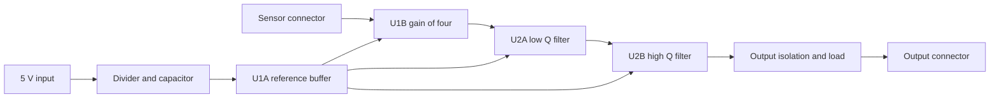

# SPICE simulation improvements and an analog example board

Research date: 13 October 2026.

Implementation follow-up: the [analog example](../examples/simulation/analog_frontend/README.md)
now has source and plans using the original TI model. Loading **both** `analog.cm`
and `xtradev.cm` resolves the earlier parsing blocker. Biased steps pass;
complete-board bias/AC and cold-start convergence remain unresolved. The native
solver proposal is deferred in favor of the off-the-shelf engine/model workflow.

CopperScript already has a useful ngspice evidence pipeline. The next investment
should be a qualified active-device model and a complete analog signal path,
followed by numerical refinement and noise analysis. A precision sensor front end
with four amplifier stages would expose practical gaps that the current passive
examples cannot exercise.

This is a development proposal. Supported commands and schemas remain in
[simulation](simulation.md); acceptance requirements remain in
[simulation qualification](simulation-qualification.md).

The compact [board specification](../examples/simulation/analog_frontend/SPEC.md)
defines the proposed consumer. [Integrated simulation options](integrated-simulation-research.md)
evaluate built-in models, a native solver and packaged engines.

## Current capabilities and verification

The board supplies connectivity, part identities and typed nominal values. A
separate plan supplies stimuli, model bindings, analyses, cases and requirements.
Simulation does not rewrite the electrical board.

| Capability | Current implementation |
| --- | --- |
| Analyses | Operating point, AC decade/octave/linear sweeps, transient |
| Stimuli | Voltage/current sources, DC and AC excitation, finite ramps, PWL, source resistance, timed current sinks |
| Selection | Whole circuit or component/module subsets, explicit external replacements and acknowledged open boundaries |
| Models | Hashed include bundles, terminal/pin mapping, explicit omitted pins, supported parts/analyses/engine versions; native subcircuits and diode/BJT/MOSFET cards |
| Cases | Named passive-value, source and load overrides; shared analyses and checks |
| Measurements | Limits on values, extrema, mean, RMS, peak-to-peak, crossings, charge and energy |
| Reports | Offline interactive HTML, SVG/PNG, complex CSV/JSON, decks/logs, engine identity and artifact hashes |
| Execution | Bounded processes or disposable DLL workers, controlled startup and fresh output directories |

Implementation lives in `pcbir/simulation/` and `pcbir/backends/ngspice.py`.
The committed examples are `examples/simulation/rc_filter.*` and `inrush.*`.
CI pins ngspice 47 in `.github/simulation-toolchain.json` and runs those examples
through `scripts/ci_simulation.py`.

Local verification passed **37 tests** in `tests/test_simulation.py`, including
simulator integration, with KiCad's ngspice 46 DLL. Coverage includes analytic RC
gain/phase, sweep grids, nonuniform integration, source-current polarity, boundary
and model rejection, and incomplete evidence. The amplifier fixture in
`test_real_vendor_style_pin_map_and_transitive_model_bundle` uses an ideal
gain-of-ten block. It exercises mapping and includes, not a manufacturer's
nonlinear amplifier. The local result does not replace qualification on version 47.

## Vendor model findings

The example dependency already exports `OPA2197ID` and `OPA2197_DIE` from
`examples/packages/compatibility/`. Their inspected requirements sections are
empty. These are device/package fixtures without reviewed operating limits,
decoupling obligations or a simulation contract.

[TI's OPA2197 product page](https://www.ti.com/product/OPA2197) offers PSpice
SBOMA34D and TINA SBOMA35C models. Inspection of the downloaded bundles found
model versions 1.3 and 1.2, respectively. Both expose a five-terminal `OPAx197`
core in order `IN+ IN- VCC VEE OUT`, with behavioral expressions and PSpice
switches. The headers carry TI copyright and warranty notices; redistribution
permission remains unresolved. Vendor files remain in local build output.

The dual package needs a reviewed eight-terminal wrapper instantiating the core
twice with shared supplies. The package mapping is:

| Function | Package pin |
| --- | --- |
| A output, inverting input, noninverting input | 1, 2, 3 |
| Negative supply | 4 |
| B noninverting input, inverting input, output | 5, 6, 7 |
| Positive supply | 8 |

Two independent cores do not establish channel interaction or shared thermal
behavior. The wrapper must disclose those omissions.

A bounded follower probe used unmodified model bytes, a 5 V supply, 2.5 V input
bias, a 10 kohm output load and AC from 10 Hz to 1 MHz:

| Initialization on local ngspice 46 | Result for both bundles |
| --- | --- |
| Current native initialization | Parse failure: undefined `temp` and switch model mismatches |
| PSpice compatibility only | Missing translated switch code-model definition |
| PSpice compatibility with explicitly loaded, hashed KiCad `analog.cm` | Parse failure naming a scoped `aswitch` model; also failed with `psa` and `ltpsa` profiles |

Some failed probes returned process status zero and wrote a **constants** raw
plot. That is not an AC solve. CopperScript's expected-analysis validation rejects
it. The remaining failure could involve model scoping, compatibility translation
or this engine build; repeat on the pinned engine before adapting the model.

This needs more than a registry entry. The
[ngspice 47 manual](https://ngspice.sourceforge.io/docs/ngspice-47-manual.pdf)
describes compatibility preprocessing and dynamically loaded XSPICE libraries.
Support should declare a reviewed dialect and required engine assets, preserve
their hashes and controlled startup, and qualify the resulting behavior. The
current adapter explicitly excludes compatibility profiles and external code models.

## Improvements in priority order

1. **Qualify one real amplifier.** Reproduce the follower on ngspice 47, resolve
   the switch/scoping failure, and compare bias, gain/bandwidth, output loading,
   slew and overload recovery against applicable vendor fixtures or datasheet
   conditions. Establish license scope and the dual wrapper. Advertised model
   capabilities are inputs to review, not qualification results.
2. **Add numerical refinement evidence.** `max_step` is configurable, while the
   deck fixes `reltol`, `abstol` and `vntol`. Start with comparisons between
   separate plans, then add typed numerical settings and automated bounded
   refinement. A proposed criterion is less than 1 percent change in key peaks
   and settling measurements after halving timestep and tightening tolerances,
   with absolute floors near zero. Retain both runs and solver diagnostics.
3. **Add DC sweeps and small-signal noise.** DC sweeps expose input range and
   clipping. Noise needs density units, integration over frequency, input-source
   normalization and qualified model coverage. Existing AC RMS is not integrated
   noise. These are adapter/data-contract gaps rather than missing engine analyses.
4. **Improve corners and stimuli.** Explicit cases work today. Add bounded
   tolerance matrices with documented correlation, followed by seeded statistical
   sampling. Current cases cannot vary models or temperature. Native sine/pulse
   stimuli would simplify distortion and recovery scenarios compared with PWL.
5. **Extend typed observables.** Ratios currently require matching operand units.
   Add voltage/current ratios in ohms for transimpedance and impedance, then
   reviewed element-current and device-internal probes. Record sensing elements
   and simulation-only topology changes explicitly.
6. **Make evidence easier to retrieve.** A compact summary should report worst
   cases, failed/incomplete checks, active-model coverage and solver warnings.
   Model assumptions reside in provenance, while the visible assumptions panel
   primarily uses plan assumptions; bring model limitations beside relevant plots.

Loop margins need an actual loop break/injection method and sign convention.
A closed-loop filter Bode plot cannot supply them. A resistor-capacitor output
load likewise cannot qualify an ADC's acquisition or charge-kickback behavior.

## Proposed precision sensor front end

Use two dual OPA2197 packages for four stages: a buffered midpoint reference,
gain-of-four amplifier and two active low-pass stages. Add supply/input/output
connectors and test points at each stage. This is a substantial consumer example
with bounded simulation cost.

Proposed input is 2.5 V plus or minus 200 mV, giving approximately 1.7 V to
3.3 V output before offset and load effects. These are design targets, not
simulation results. The midpoint tracks the supply; it is not a precision
voltage reference.

| Section | Starting values |
| --- | --- |
| Reference | 10 kohm / 10 kohm divider, 1 uF before U1A, buffered nominal 2.5 V |
| Gain | 30 kohm feedback and 10 kohm to buffered reference; nominal gain four |
| First unity-gain Sallen-Key stage | Two 7.32 kohm resistors, 12 nF feedback capacitor, 10 nF to reference |
| Second unity-gain Sallen-Key stage | Two 3.01 kohm resistors, 68 nF feedback capacitor, 10 nF to reference |
| Output | Initial 47 ohm isolation, 1 nF load capacitance, 10 kohm load; verify before fixing values |
| Supply | Pin-associated 100 nF bypass for each package, illustrative 4.7 uF board bulk |

The filter target is approximately fourth-order Butterworth at 2 kHz. For equal
resistors within each unity-gain stage, `Q = sqrt(C_feedback/C_ground)/2` and
`f0 = 1/(2*pi*R*sqrt(C_feedback*C_ground))`. Ideal fourth-order factors have
Q values 0.5412 and 1.3066; these standard values calculate to approximately
0.5477 at 1.985 kHz and 1.3038 at 2.028 kHz. Use the lower-Q stage first to limit
intermediate amplification. Finite amplifier behavior and output loading affect
the final response. The topology/cascade method follows
[TI's filter guide](https://www.ti.com/lit/an/sloa049d/sloa049d.pdf); these particular
component values are calculated starting points.

The [OPA2197 datasheet](https://www.ti.com/lit/ds/symlink/opa2197.pdf) permits the
proposed 5 V supply and specifies local 100 nF bypassing and careful feedback
layout. Review output-load stability and place the reference capacitor before its
buffer. Exact passive SKUs, bias behavior, tolerances and footprint pins remain
to be selected and verified.

## Plans and acceptance for the board

Separate cold startup from biased small-signal/step plans so DC bias and waveform
initial conditions remain consistent.

| Plan | Proposed checks | Current readiness |
| --- | --- | --- |
| Bias and AC | Reference/output bias, gain near 12.04 dB at 100 Hz, cutoff near 2 kHz, stopband rejection, stage peaking | OP/AC checks supported; active model unresolved |
| Signal step | Final value, overshoot, error envelope throughout a settling window, headroom | PWL and windowed extrema supported; model applicability needs review |
| Cold startup | Reference charging, supply current, output excursion, final envelope | Ramp/transient supported; cold-start model validity unresolved |
| Corners | Resistors 1 percent, capacitors 5 percent, unequal capacitor corners, 4.75 V/5.25 V supplies, 10 kohm/2 kohm loads, 1 nF/10 nF capacitance | Explicit passive/source cases supported; bounded matrix needed |
| Noise and overload | Integrated input/output noise, saturation onset, recovery | Noise/DC work needed; overload can initially use qualified PWL scenarios |

Initial nominal targets could be 11.9 dB to 12.2 dB at 100 Hz and cutoff between
1.8 kHz and 2.2 kHz; corner limits must come from actual requirements. For nominal
gain four, existing absolute crossing checks can use 9.03 dB for the nominal
minus-3 dB point. Bandwidth relative to each case's measured passband gain needs
additional measurement composition or explicit postprocessing. An `at` check
alone cannot establish that the output stayed settled throughout a window.

The future consumer should live under `examples/simulation/analog_frontend/`
with board source, separate plans, reviewed registry/wrapper and board guide.
Reuse inspected dependencies; keep reusable definitions in independently versioned
libraries and do not expand CopperLib for this work. Apply existing connector
boundary coverage, pin real footprints and use ordinary bounded `route-board`
for the physical board.

Completion needs active-model qualification on the pinned engine, analytic
cross-checks, negative evidence cases, reviewed corner limits and fresh reports.
Simulation, routing and DRC remain separate from prototype/release qualification.
Parasitic claims need reviewed extraction or explicit bounds tied to the board
revision. The board is specified here; it has not been implemented or routed.

## Later photodiode example

A photodiode transimpedance amplifier followed by gain/filtering would exercise
detector capacitance, leakage, compensation and very small signals once typed
current-to-voltage ratios and noise are supported. Those effects directly affect
stability and noise, as explained in
[Analog Devices' transimpedance guidance](https://www.analog.com/en/resources/technical-articles/stabilize-transimpedance-amplifier-circuit-design.html).
Choose a real detector and scenario before selecting capacitance and compensation.
