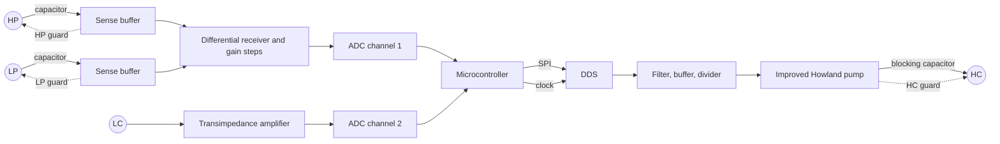

# Soil impedance analyzer board specification

Status: 19 November 2026. The whole board exists as a schematic:
`board.copper` (board `ImpedanceAnalyzer`, the digital and power section) with
the analog front end as the module `AnalogFrontEnd` (`analog/front_end.copper`).
It passes ERC (also with `--pins error`) and the power-state check, and the
front end has P0, P1 and P2 benches (AC, noise, Monte Carlo and worst case,
transient), which simulate the module on its own; results, corrections and
open items are in [README.md](README.md). The benches pass over the rated
range ([Usable range](#usable-range)); conditions outside it are simulated in
the same benches and reported without accuracy limits. No layout. Numbers the simulation checked are written
"estimated X, simulated Y"; the rest are still hand estimates or starting
values. Part facts marked *verify* were checked against data sheets for the
analog parts and the digital and power parts (README.md, "Data-sheet
facts").

This board is the first consumer of the
[integrated simulation plan](../../../docs/integrated-simulation-plan.md): each
plan phase is done when the matching bench below passes.

## Purpose

A four-terminal (Kelvin) impedance analyzer for soil. The lower part of the
board is a stake with four exposed copper electrodes that is pushed into the
ground; the electronics stay above it. A microcontroller sets a DDS sine from
1 kHz to 1 MHz, an improved Howland current pump drives 30 uA peak to peak
through the outer electrodes, and the board measures the voltage across the
inner electrodes and the current that actually flowed. Impedance magnitude and
phase over frequency come from the ratio of the two.

At the low end of the band the result follows soil conductivity (salinity,
moisture). Towards 1 MHz the phase follows soil permittivity (moisture).

## Requirements

| Item | Requirement |
| --- | --- |
| Frequency | 1 kHz to 1 MHz, sine |
| Drive current | 30 uA peak to peak (15 uA peak) |
| DC through the soil | None: the drive and both sense inputs are capacitor coupled |
| Drive impedance, both current contacts plus soil | Up to 150 kohm |
| Compliance | 2.25 V peak at the electrode, 2.4 V at the pump output |
| Measured impedance (sense voltage over current) | 40 ohm to 11 kohm |
| Soil resistivity covered | About 5 ohm m to 1.3 kohm m with the electrodes below |
| Current measurement | Measured, not assumed; error at most 0.5 % of reading after calibration |
| Impedance result on the calibration card | Magnitude within 1 %, phase within 1 degree, 1 kHz to 1 MHz, on every rated position: 39 ohm and 1 kohm, each with 0 ohm or soil-like contacts (270 ohm and 6.8 kohm), and 10 kohm with 0 ohm (simulated: at most 0.52 % and 0.22 degrees, `CalibrationCard`). The 10 kohm position with 68 kohm contacts is a dry-soil check outside the rated range, reported (simulated 37.7 % and 16.7 degrees at 1 MHz, within 1 % and 1 degree up to 141 kHz, same bench) |
| Impedance result in soil | Same, 1 kHz to 1 MHz, over the rated range of [Usable range](#usable-range): 5 to 100 ohm m, contacts matched as stated there (simulated: at most 0.39 % and 0.15 degrees with equal contacts). Above 100 ohm m the same accuracy holds up to a lower frequency, about 160 kHz times 1 kohm m over the resistivity (simulated: 821 kHz at 200 ohm m, 129 kHz at 1.3 kohm m, `SoilSweep`) |
| Common-mode rejection of the sense path | At least 63 dB at 1 MHz over the rated range (contacts up to 5.58 kohm, either sense buffer at its minimum CMRR). 63 dB at a common-mode ratio of 7 to 8 keeps this error under 0.57 %, which leaves room for the 0.39 % of the soil result. Simulated at the receiver's output `V_D`, so that the ADC channels' own responses do not enter: 66.7 dB worst, 84.4 dB with matched buffers (`SenseCommonMode`). Corrected from 70 dB, which one buffer at its data-sheet minimum misses (69.8 dB with no contacts). Drier soil is reported: 48.9 dB at 72.5 kohm contacts (same bench). Mismatched coupling capacitors (10 % X7R assumed) alone, with matched buffers: 77.6 dB at 1 MHz and 100 ohm m in the worst case (`ResistorWorstCase`); with a minimum-CMRR buffer at once not simulated |
| Electrodes | Four exposed pads on the board, in line: high current (HC), high potential (HP), low potential (LP), low current (LC) |
| Probe access | Pin header carrying HC, HP, LP, LC, guards and ground, for debugging and for external leads |
| Supply | One protected Li-ion or LiPo cell (3.0-4.2 V, 2000 mAh assumed), charged from USB-C (303 mA); the front end switched off between measurements. Estimated (README.md, "Current budget and battery life"): 232 mA typical, 263 mA maximum from the cell at 3.7 V while measuring (front end 51.8 mA typical, 56.9 mA maximum per analog rail, 3.7 mA on its switched 3.3 V); 41 uA typical, under 90 uA worst case in sleep; about 8.6 h of continuous measurement, about 35 days (31 days worst case) at 5 s every 10 minutes |

The accuracy rows are targets to test by simulation, not results.

## Soil range

Two impedances matter and both scale with soil resistivity. For electrode
spacing `a` and a pad of equivalent radius `r` on a half-space:

- measured impedance, `resistivity / (2 pi a)`;
- contact resistance of one electrode, `resistivity / (4 r)`.

With 8 mm by 8 mm pads (`r` about 4.5 mm) on a 20 mm pitch:

| Soil | Resistivity | Measured impedance | Sense voltage, peak | One contact | Drive impedance |
| --- | --- | --- | --- | --- | --- |
| Saline or wet clay | 5 ohm m | 40 ohm | 0.6 mV | 0.3 kohm | 0.6 kohm |
| Moist loam | 100 ohm m | 800 ohm | 12 mV | 5.6 kohm | 11 kohm |
| Dry loam or sand | 1 kohm m | 8 kohm | 120 mV | 56 kohm | 110 kohm |
| Limit of this board | 1.3 kohm m | 11 kohm | 160 mV | 75 kohm | 150 kohm |
| Very dry sand | 10 kohm m | 80 kohm | 1.2 V | 560 kohm | 1.1 Mohm, out of range |

Real contact in dry, loose soil is worse than the formula. The frequency where
soil's capacitive current equals its resistive current is about 7 MHz for moist
loam (relative permittivity 25) and about 700 kHz at 1 kohm m, so the load is
not a plain resistor near the top of the band.

The common-mode voltage on the sense electrodes is the drop across the LC
contact. Its ratio to the sense voltage is `2 pi a / (4 r)`, about 7, whatever
the resistivity. At 70 dB rejection that leaves about 0.2 % error, at 63 dB
about 0.5 %.

## Usable range

The board meets 1 % and 1 degree only where each sense node's 1.6 pF (the
ADA4817's own 1.3 pF plus 0.3 pF residual) stays small against the contact
resistances. The owner accepted this limit; the circuit is not changed for it.
Numbers are from `copper sim` (README.md, "Results").

**Rated range: 1 % and 1 degree from 1 kHz to 1 MHz**, after calibration on
the card, when all of these hold:

| Condition | Rated | Simulated worst case | Bench |
| --- | --- | --- | --- |
| Soil | 5 to 100 ohm m, relative permittivity 5 to 40, contacts 0.28 to 5.58 kohm | 0.39 %, 0.15 degrees | `SoilSweep` |
| Sense contacts (HP, LP) | differ by at most 100 ohm | 0.73 %, 0.997 degrees (0.89 % and 0.91 degrees before 23 November 2026) | `ContactImbalance` |
| LC contact | differs from the sense contacts by at most 200 ohm | (same bench) | `ContactImbalance` |
| HC contact | any value the pump can drive (tested 10 times the others) | no change | `ContactImbalance` |
| Sense buffers | typical to data-sheet minimum CMRR | 66.7 dB, limit 63 dB | `SenseCommonMode` |
| Residual capacitance, each guarded node to ground | at most 1 pF besides the buffer's own 1.3 pF | 0.94 %, 0.58 degrees with the mask coupling below | `StrayCapacitance` |
| Soil to ground copper through solder mask, near LP | at most 0.2 pF (about 0.13 mm2 under 20 um of mask) | (same bench) | `StrayCapacitance` |
| Guards | driven | | all |

Each bench varies its own conditions with the others nominal. The worst cases
do not form a combined budget: conditions of different benches at their edges
at once can exceed 1 % (hand estimate: 0.75 % for 1 pF of residual plus
0.32 % for a minimum-CMRR buffer at 100 ohm m).

**Degraded range: drier soil.** With equal contacts the error grows at the top
of the band. 1 % and 1 degree then hold from 1 kHz up to about
`160 kHz x (1 kohm m / resistivity)`, worst of relative permittivity 5, 25 and
40 (`SoilSweep`, `usable_to_magnitude` and `usable_to_phase`, interpolated
between the 20-per-decade samples):

| Resistivity | 1 % and 1 degree up to | Worst error at 100 kHz | at 1 MHz |
| --- | --- | --- | --- |
| 100 ohm m | 1 MHz | 0.025 %, 0.002 degrees | 0.39 %, 0.15 degrees |
| 150 ohm m | 1 MHz | 0.029 %, 0.002 degrees | 0.87 %, 0.28 degrees |
| 200 ohm m | 821 kHz | 0.035 %, 0.002 degrees | 1.5 %, 0.41 degrees |
| 300 ohm m | 560 kHz | 0.051 %, 0.001 degrees | 3.7 %, 0.78 degrees |
| 500 ohm m | 343 kHz | 0.10 %, 0.010 degrees | 10 %, 2.4 degrees |
| 1 kohm m | 176 kHz | 0.34 %, 0.084 degrees | 20 %, 11 degrees |
| 1.3 kohm m | 129 kHz | 0.61 %, 0.20 degrees | 16 %, 19 degrees |

150 ohm m still meets 1 % and 1 degree on its own; the rating stops at 100 ohm m
because the common-mode error of a minimum-CMRR buffer comes on top (63 dB
is not met at 200 ohm m: 62.7 dB, `SenseCommonMode`).

**Degraded range: unequal contacts.** A sense contact that differs from the
other one by `dR` turns the common mode, about 7 times the sense voltage, into
a phase error through the node's 1.6 pF (`ContactImbalance`, simulated
coefficients):

- phase error about 0.4 to 0.5 degrees per 100 ohm of HP-LP difference per MHz
  (LP higher: 0.40 to 0.41 up to 100 kHz, 0.38 to 0.45 at 1 MHz; HP higher:
  0.45 to 0.47 up to 100 kHz, 0.39 to 0.51 at 1 MHz; the 1 MHz coefficients
  date from before 23 November 2026 and were not regenerated);
- an LC contact that differs from the sense contacts costs 0.06 to 0.07 degrees
  per 100 ohm per MHz;
- at 5 ohm m and 1 MHz a high HP contact also costs about 0.5 % of magnitude
  per 100 ohm;
- so 1 % and 1 degree hold up to about `200 kHz x (1 kohm / dR)` for a sense
  contact and `1.5 MHz x (1 kohm / dR)` for the LC contact (simulated 198 to
  224 kHz kohm and 1.4 to 1.6 MHz kohm, for 5 ohm m and 100 ohm m soil).

The rule holds while the phase error stays below about 10 degrees. Above that
it overstates the error (one sense contact 10 times the others at 100 ohm m:
100.4 degrees at 1 MHz, against about 250 degrees from the rule), and below
10 kHz a sense contact tens of kohm too high adds a flat magnitude error
(1.13 % at 10 kHz for 50 kohm; by hand, the 33 Mohm bias resistor loading the
contact at 8 times the sense voltage: 8 x 50 kohm / 33 Mohm = 1.2 %). A worse
LC contact also raises the common-mode ratio, which scales the sense-contact
term. The contacts change at every insertion, so calibration cannot remove any
of this. A measurement of each contact (for example through the probe header)
tells up to which frequency a reading is valid.

**Layout requirements the rating assumes** (`StrayCapacitance`): guards
driven (grounded guards: 1 % and 1 degree only up to 132 kHz); at most 1 pF of residual capacitance from each guarded node to
ground (1.5 pF already exceeds 1 % at 1 MHz); no ground copper facing the soil
in the buried part, at most 0.2 pF of coupling near LP (0.5 pF exceeds
1 degree at 1 MHz; 10 pF costs 18 degrees). See
[Board shape and layout notes for later](#board-shape-and-layout-notes-for-later).

## Architecture

### Why the current is measured on the low side

The transimpedance amplifier holds the LC electrode at virtual ground and
converts the current arriving there to a voltage. That current is what went
through the soil. Stray capacitance from the HC and HP nodes to ground steals
current before the soil, so it never reaches the amplifier and does not corrupt
the ratio.

The pump therefore only has to deliver roughly the right current. The ratio
`V_sense / I_measured` carries the accuracy.

### Why three nodes are guarded

**HC.** The pump must charge whatever capacitance hangs on the HC node, through
the 10 kohm set resistor. At the largest drive impedance (2.25 V on the node)
and 1 MHz:

| Capacitance on the HC node | Extra current | Extra drop on 10 kohm |
| --- | --- | --- |
| 3 pF | 42 uA | 0.42 V |
| 5 pF | 71 uA | 0.71 V, the headroom left |
| 12 pF (an unguarded 8 mm pad over a plane 0.2 mm below) | 170 uA | 1.7 V, out of range |

Simulation corrects this table: the pump regulates the current through
R_SET, so capacitance on HC does not add a drop on R_SET; it diverts current
from the soil instead (simulated: 4 to 8 uA of 15 uA reach 1 kohm m soil at
1 MHz, with the HC node guarded). Accuracy is unaffected because the current
is measured at LC; the guard still matters for signal level.

So the copper under the HC pad and around its trace is driven with a copy of
the HC voltage. The improved Howland pump already has that copy: the output of
its feedback buffer.

**HP and LP.** Each sense electrode has a contact resistance of up to 75 kohm.
Against the capacitance of its trace and buffer input this forms a low-pass:

| One contact | 2 pF on the node | 0.3 pF on the node (guarded) |
| --- | --- | --- |
| 5.6 kohm (100 ohm m) | Pole 14 MHz, 4 degrees at 1 MHz | Pole 95 MHz, 0.6 degrees |
| 56 kohm (1 kohm m) | Pole 1.4 MHz, 35 degrees at 1 MHz | Pole 9.5 MHz, 6 degrees |

Simulation corrects the 0.3 pF: the buffer's own input capacitance (1.3 pF for
the ADA4817) cannot be guarded, so the guarded node is about 1.6 pF (estimated
0.3 pF, simulated 1.6 pF). With equal contacts the poles of HP and LP largely
cancel (simulated 0.15 degrees at 100 ohm m, 2.5 to 11 degrees at 1 kohm m); an
unequal contact turns the common mode into error (README.md,
"ContactImbalance"). The limits this sets are under
[Usable range](#usable-range).

Each sense trace therefore runs inside copper driven by its own buffer output.
LP needs this as much as HP, because LP sits at the common-mode voltage, not at
ground. Even guarded, dry soil costs phase accuracy at the top of the band;
this cannot be calibrated out because the contact changes with every
insertion.

**LC** sits at virtual ground and is surrounded by ground.

External leads on the header are only usable for loads far below the limit,
unless they are coaxial with the shield on the matching guard pin.

## Blocks and starting values

| Block | Starting design |
| --- | --- |
| DDS | AD9833, 25 MHz clock from a microcontroller timer output so that sampling is coherent (verified: TIM1_CH1, 150 MHz / 6 = 25 MHz, README.md "Clock configuration"). Output about 0.6 V peak to peak on a 0.3 V offset, 200 ohm internal load (*verify*). |
| Filter, buffer, divider | Passive LC low-pass, corner near 3 MHz, AC coupling with a corner at or below 16 Hz, a unity buffer, then a divide-by-two to 0.15 V peak. As built: a 3rd-order Butterworth terminated in 200 ohm, which halves the DDS amplitude itself, so no divider. |
| Current pump | Improved Howland with a buffer in the positive-feedback path, so the set resistor carries only load current. Four 10 kohm gain resistors as one ratio-matched network, 0.01 % ratio. Set resistor 10 kohm, 0.1 %. `I = V_in / R_set` = 15 uA peak. |
| DC blocking, drive | 1 uF film or C0G capacitor in series with HC, after the node the pump regulates. 10 Mohm from that node to ground gives the amplifier inputs a DC path. Corrected: 10 Mohm turns the pump's offset current (up to 0.4 uA) into up to 4 V; built instead with a 4.7 uF capacitor in series with R3 (unity DC gain, node at +24 mV simulated) and a 100 nF blocking capacitor for a short start-up. |
| Pump amplifiers | ADA4817 class: FET input, about 400 MHz gain-bandwidth, about 1.3 pF input capacitance (verified: 410 MHz, 1.3 pF). Corrected: the pump's 1 MHz output impedance is set by the strays on HC, not by gain-bandwidth, so the board uses the 1 mA ADA4807 (180 MHz) for the pump and its feedback buffer. |
| Electrodes | Four exposed pads, 8 mm by 8 mm on a 20 mm pitch, gold finish (ENIG), each a one-pad part so it carries a net. Size and pitch are parameters. |
| Sense buffers | One FET-input follower per potential electrode, same amplifier type, coupled through 10 nF with 100 Mohm bias. Each output drives its own guard through 50 to 100 ohm. As built: ADA4817, 4.7 nF and 33 Mohm (155 ms instead of 1 s), 49.9 ohm to the guard. |
| Differential receiver | AD8130 class: both inputs high impedance, about 80 dB common-mode rejection at 2 MHz (verified: 80 dB minimum at 2 MHz). This is the instrumentation amplifier of the board; classic monolithic ones lack the bandwidth. Followed by gain steps of 1, 10 and 100 in two stages. Covers 0.6 mV to 160 mV peak. As built: 2.2 pF across each gain stage's 9.09 kohm (8 MHz) and 100 ohm into 1 nF on the gain-1 ADC input (1.59 MHz; the other three channels 49.9 ohm into 470 pF, 6.8 MHz), both for the vendor model's margins and peaking ([Vendor models](#vendor-models)); at 1 MHz the gain-1 channel then passes 84.7 % with -32.8 degrees, the gain-10 channel 97.5 % with -18.2 degrees (before: 98.9 % and -9.1, 98.9 % and -11.8 degrees), all calibrated out. |
| Transimpedance amplifier | 20 kohm feedback, 0.1 %, giving 0.3 V peak. About 1 pF across it; bandwidth about 8 MHz. As built: ADA4807 on 3.3 V with LC at V_MID, 10 pF (0.8 MHz, no peaking; 1.5 pF and 5.3 MHz until 23 November 2026, see [Vendor models](#vendor-models)); at 1 MHz the current channel passes 61.9 % with 60.7 degrees of lag (98.6 % and 19.7 degrees with 1.5 pF), calibrated out, and its signal there falls to 0.19 V peak at most. The gain stages are also on 3.3 V, so no ADC input can leave 0 to 3.3 V. |
| ADC | Two of the 12-bit converters in the microcontroller in dual simultaneous mode, up to 4 Msps (*verify*), so four samples per period at 1 MHz. I/Q demodulation in firmware over an integer number of periods; averaging recovers resolution. |
| Microcontroller | STM32G474CET6, LQFP48; part and device definition in `parts/`. |
| Calibration | A separate small card with four matching pads that the stake presses onto. 0.1 % reference resistors of 39 ohm, 1 kohm and 10 kohm between the sense pads, each with a choice of 0 ohm or soil-like resistors in series with every pad: 270 ohm with 39 ohm, 6.8 kohm with 1 kohm, 68 kohm with 10 kohm (soil contacts are 6.98 times the transfer impedance for this geometry), plus short and open positions. Calibration on 1 kohm with 0 ohm. Rated (1 % and 1 degree): 39 ohm and 1 kohm with either contacts, 10 kohm with 0 ohm. 10 kohm with 68 kohm imitates 1.26 kohm m soil, outside the rated range: a check that the board degrades as simulated. Corrected: the first design had 47 kohm on every position, which is not soil-like (27 to 34 % at 1 MHz, `CalibrationCard`). |
| Rails | Split analog rails of about plus and minus 4.5 V from low-noise linear regulators behind an inverting converter. The amplifier's total supply limit is about 10 V (verified: ADA4817 5 to 10 V, absolute maximum 10.6 V). 3.3 V digital. Analog load: 51.8 mA typical, 56.9 mA maximum per rail, 3.7 mA on 3.3 V. As built: TPS65130 boost and inverter (+5.34 V, -5.24 V), TPS7A4901 and TPS7A3001 to +4.50 V and -4.48 V, REF2033 for the 1.65 V mid-supply, all switched with `ANA_EN`; TPS63020 buck-boost for the always-on 3.3 V; the front end's 3.3 V is a switched branch of it (the DDS load switch, through its own ferrite), so nothing analog loads the always-on rail in sleep. |
| Connectors | USB-C for charging and data, a JST-PH battery connector, a debug (SWD and UART) header, and the probe access header. |

Parts not yet in a library are example-local parts in `parts/` and move to
CopperLib after review.

## Estimates the simulation must confirm

| Quantity | Hand estimate | Basis | Simulated (README.md) |
| --- | --- | --- | --- |
| Pump output impedance from resistor mismatch | About 200 Mohm at 0.01 % ratio, then capped at 10 Mohm by the DC path resistor | `2 R_set / ratio error`; checked in `copper-sim` tests | estimated 200 Mohm, simulated 6.2 Mohm at 1 kHz, set by the DC servo that replaced the 10 Mohm; with the LT5400's 0.0125 % ratio and the other tolerances 5.07 to 7.55 Mohm worst case, the ratio moving it by 34 kohm (`ResistorWorstCase`) |
| Pump output impedance at 1 MHz from finite gain-bandwidth | About 1.3 Mohm, 9 times the largest load | `R_set * GBW / (3 f)` when the feedback buffer is the same amplifier; checked in `copper-sim` tests | 87 kohm, set by the strays on HC, not by gain-bandwidth |
| Same with a 50 MHz amplifier | About 170 kohm, about equal to the largest load | Same formula; why a fast amplifier is specified | not needed: stray-limited, and the current is measured |
| Pump output swing at the limit | 2.4 V plus up to 0.7 V for stray capacitance, of 3.1 V available | 150 kohm at 15 uA; rails less 1.4 V | 2.43 V at the node, 2.58 V at the amplifier, of 4.4 V (rail-to-rail ADA4807); strays add no swing |
| Common-mode error | 0.2 % at 70 dB rejection | Common mode about 7 times the sense voltage | 0.022 % with the receiver at its 90 dB minimum and matched buffers |
| Sense contact pole | See the guard table | Contact resistance against node capacitance | node 1.6 pF, not 0.3 pF; see the guard table note |
| Transimpedance phase lag at 1 MHz | About 7 degrees | 8 MHz single pole; removed by calibration | 52 degrees with 10 pF (0.8 MHz; 10.7 degrees with the 1.5 pF before 23 November 2026), 60.7 for the current channel with its anti-alias RC; the impedance before calibration 27.6 to 27.7 degrees on the rated soils, 0 after |
| Current-channel noise | About 0.9 pA per root hertz, far below 15 uA in a 1 kHz detection bandwidth | Thermal noise of 20 kohm | estimated 0.9 pA/rtHz, simulated 4.0 pA/rtHz at 1 kHz referred to the current: 1.55 pA/rtHz the transimpedance stage, the rest the drive's own current noise, which cancels in the impedance; 98 dB SNR in 1 kHz (`MeasurementNoise`) |
| Voltage-channel noise at the smallest signal | not estimated | | simulated 22 nV/rtHz at 1 kHz, 15 nV/rtHz above 10 kHz referred to the sense electrodes; 55 to 59 dB SNR for 0.6 mV in 1 kHz: the impedance's noise 0.12 % and 0.070 degrees RMS at 5 ohm m (`MeasurementNoise`, `noise(z1)`) |
| Slew rate needed | 20 V/us | 3.1 V peak at 1 MHz | estimated 20 V/us; simulated: the pump output peaks at 2.59 V at 1 kHz but only 0.61 V at 1 MHz (the strays take the current there), so the largest slew needed is 3.8 V/us at 1 MHz, against 225 V/us; no harmonic from slewing (`Distortion`) |
| Start-up | not estimated here (README.md: 0.8 s from the slowest coupling network) | | simulated: every ADC input within 1 mV 0.68 s after `ANA_EN`, inside the 1 s the battery budget allows (`Startup`, rails from models of the regulators) |
| Guard loop stability | Unknown | The HC guard feeds the pump's own buffer output back to its input node through the pad capacitance | stable with the macro models: no pole in the right half-plane with the electrodes in air (`GuardStability`) or in soil (`LoopStability`); the least damped pair is 4.06 kHz with damping 0.27 in air, the mode behind the -42.5 kohm negative real part |

## Benches

Every bench uses the same soil model: a contact resistance in series with each
electrode, the measured impedance between the sense nodes, and a capacitor
across each of those for the soil's permittivity. Resistivity and permittivity
are bench parameters.

A bench steps over conditions inside the rated range ([Usable range](#usable-range))
and outside it; its accuracy limits apply to the rated steps only (`where`),
its headroom limits to every step. The shared setup (port conditions, soil
model and strays, the firmware's arithmetic, the tolerances) is in fixtures
(README.md, "Benches").

| Bench | Question | Plan phase | Status |
| --- | --- | --- | --- |
| `SoilSweep` | Magnitude and phase of the computed impedance against the model, 1 kHz to 1 MHz, 5 ohm m to 1.3 kohm m, relative permittivity 5 to 40; limits 1 % and 1 degree to 100 ohm m; usable frequency above it | P0 | pass |
| `CalibrationCard` | Same sweep on the card's positions; limits 1 % and 1 degree on the rated ones (39 ohm and 1 kohm with 0 ohm or soil-like contacts, 10 kohm with 0 ohm); 10 kohm with 68 kohm and the former 47 kohm contacts reported | P0 | pass |
| `StrayCapacitance` | `SoilSweep` at 100 ohm m with strays: limits 1 % and 1 degree up to 1 pF residual and 0.2 pF of mask coupling near LP; 0.3 to 20 pF residual, grounded guards, up to 100 pF of mask coupling reported | P0 | pass |
| `ContactImbalance` | Unequal contacts: limits 1 % and 1 degree within the rating (sense contacts 100 ohm apart, LC 200 ohm, HC 10 times); one contact 5 % to 10 times worse reported | P0 | pass |
| `SenseCommonMode` | Common-mode rejection of the sense path; limit 63 dB with contacts up to 5.58 kohm, 11.2 to 72.5 kohm reported | P0 | pass |
| `PumpOutputImpedance` | Output impedance of the pump against frequency; peaking as a stability warning, with the guard connected | P0 | pass |
| `LoopStability` | Phase margin of every amplifier's loop at its output pin (limit 45 degrees) and the poles of the front end in soil (no pole in the right half-plane) | P0 | pass |
| `GuardStability` | The poles with the electrodes in air and the HC guard connected (no pole in the right half-plane); the pump and feedback-buffer phase margins | P0 | pass |
| `MeasurementNoise` | Noise on each ADC channel in a 1 kHz detection bandwidth at the soil corners (5, 100, 1300 ohm m); SNR, resolution, contributors (one noise analysis with the four ADC inputs as outputs), and the noise of the computed impedance | P1 | reported (no requirement) |
| `ResistorMatching`, `ResistorWorstCase` | Monte Carlo and worst case over the tolerances and the matched network; spread of drive current, output impedance, gain before calibration and common-mode rejection; limits 1 %, 1 degree and 0.5 % after calibration | P1 | pass |
| `Startup` | Rails from models of the regulators (TPS65130, TPS7A4901, TPS7A3001, REF2033), coupling and blocking capacitors charge, input ranges, no latch-up of the pump with the electrodes in air; limit: settled within 1 s | P2, F4 | pass |
| `Distortion` | Harmonics of the drive current at 1 kHz, 100 kHz and 1 MHz into 160 kohm (1.3 kohm m) and 12 kohm (100 ohm m); clipping and slew headroom | P2 | reported (no requirement) |
| `SupplyCurrent` | Current per rail from the amplifiers' typical quiescent currents and the currents their outputs deliver: idle, and driving 1 MHz at 0.3 V and 0.65 V into dry soil and at 0.3 V into moist loam; limit 70 mA per +/-4.5 V rail (what the rails are sized for) | F4 | pass |
| `VendorModels` | `SoilSweep` again with vendor amplifier subcircuits read by `copper`; difference from the built-in models | P3 | not a bench: every bench runs with `copper sim --models vendor` ([Vendor models](#vendor-models)) |
| `WithLayout` | `SoilSweep` and `StrayCapacitance` with extracted trace and electrode capacitance | P5 | not written |

## Vendor models

22 November 2026 (plan I3). The three amplifiers' Analog Devices SPICE
models, downloaded by hand and registered with `copper models add` (never
committed; the part files say how), run in every bench with `copper sim
--models vendor`. The models load unchanged and agree with ngspice-46; their
differences from the data sheet are their own (the blocks' `note`s and
`docs/simulation-improvement-plan.md`, I3). Without the files the board
runs the macro models as before.

**The circuit since 23 November 2026.** The owner chose the board change of
the options below, and it is now the circuit (`analog/front_end.copper`):
2.2 pF (`C_G1F`, `C_G2F`) across each gain stage's 9.09 kohm, the
transimpedance feedback capacitor (`C_FB_TIA`) 1.5 pF to 10 pF, and the gain-1
driver's anti-alias network (`R_AA1`, `C_AA1`) 49.9 ohm into 470 pF to
100 ohm into 1 nF. The option as first applied had 200 ohm into 470 pF; that
put PA1 above the 100 ohm that 2.5-cycle sampling allows (README.md, DS12288
Table 70), and the ADC timing (3.125 Msps, 16 ADC clocks a trigger) leaves no
room for a longer sampling time. The gain-1 network mostly filters the
follower's own closed-loop peak at the pin (the bare vendor follower peaks
1.1 dB). Measured on the vendor models, `LoopPeaking.gain1_driver` and the
`LoopStability.gain1_driver` margin: 49.9 ohm and 470 pF 1.253 and
55.9 degrees; 100 ohm and 470 pF 1.145; 150 ohm and 470 pF 1.125; 200 ohm and
470 pF 1.118 and 60.8 degrees; 100 ohm and 680 pF 1.133 and 62.0 degrees;
100 ohm and 1 nF 1.124 and 62.5 degrees; 100 ohm and 1.2 nF 1.121 and
62.7 degrees. 100 ohm into 1 nF has the best margin of those that meet the
ADC's 100 ohm and misses the 1.12 peaking limit by 0.004 on the vendor models.
Also tried and dropped: the follower at a noise gain of 2 (1.1 kohm feedback,
100 ohm across the inputs) with 49.9 ohm into 470 pF, peaking 1.397 and
46.7 degrees. What the change costs, default (macro) models:

- the transimpedance stage's bandwidth falls to 0.8 MHz; at 1 MHz the current
  channel passes 61.9 % with 60.7 degrees of lag (98.6 % and 19.7 degrees
  before), so its signal there is at most 0.19 V peak instead of 0.30 V;
- the gain-1 channel's anti-alias pole is at 1.59 MHz against 6.8 MHz on the
  other three; at 1 MHz it passes 84.7 % with -32.8 degrees, the gain-10
  channel 97.5 % with -18.2 degrees, the gain-100 channel 96.1 % with
  -28.0 degrees (98.9 % and -9.1, 98.9 % and -11.8, 98.8 % and -15.2 degrees
  before; an untracked scratch bench at 800 ohm). Calibration removes each
  channel's response; the impedance before calibration is now 27.6 to
  27.7 degrees off at 1 MHz on the rated soils (10.3 to 10.5 before);
- `ContactImbalance`'s worst rated step (HP 100 ohm low, LC 200 ohm high,
  5 ohm m) is 0.997 degrees against its 1 degree limit (0.91 before);
- PA1 sees 100 ohm plus the follower's output impedance, at the limit of
  2.5-cycle sampling.

`SenseCommonMode` and the tolerance benches now take the rejection at `V_D`,
the receiver's output, instead of `V_MON_1`, so the gain-1 channel's response
does not enter it.

With the default models every bench passes: `SoilSweep` 0.39 % and
0.15 degrees, `CalibrationCard` 0.52 % and 0.22 degrees, `StrayCapacitance`
0.94 % and 0.58 degrees, `ContactImbalance` 0.73 % and 0.997 degrees,
`SenseCommonMode` 66.7 dB; `LoopStability` gain stages 91.6 and
91.7 degrees, transimpedance 80.2 (71.6, 71.6 and 67.9 before), the others
unchanged.

With the vendor models on the final board (100 ohm into 1 nF): `LoopStability` pump 54.25, feedback buffer 64.58, receiver 58.23, gain 1 62.54, gain 10 72.5, gain 100 73.0, transimpedance 47.31 degrees and its poles pass; the drive buffer (43.3) and the sense buffer (41.5) fail; `LoopPeaking` gain 10 1.027, gain 100 1.026, receiver 1.056 pass, the drive buffer (1.331), the sense buffer (1.517) and the gain-1 driver (1.124 against 1.12) fail; `SenseCommonMode` 63.95 dB (limit 63), `SoilSweep` 0.35 % and 0.091 degrees and `StrayCapacitance` 0.88 % and 0.48 degrees pass; `CalibrationCard` and `GuardStability` were not rerun on the final board (measured, `--models vendor`, 23 November 2026).

With the vendor models on the board as first changed (200 ohm into 470 pF on
the gain-1 channel; measured, `--models vendor`):

- pass: `LoopStability` pump 54.25 degrees, feedback buffer 64.58, receiver
  58.23, gain-1 driver 60.78, gain 10 72.5, gain 100 73.0, transimpedance
  47.31, and its poles (none in the right half-plane); `LoopPeaking` gain-1
  driver 1.118 (limit 1.12), gain 10 1.027, gain 100 1.026, receiver 1.056;
  `SoilSweep` 0.35 % and 0.091 degrees; `StrayCapacitance` 0.88 % and
  0.48 degrees (all 10 limits);
- still fail: the drive buffer (`LoopStability` 43.3 degrees, `LoopPeaking`
  1.331) and the HP sense buffer (41.5 degrees, peaking 1.517), which the
  change does not touch, for the reasons below;
- not settled: `GuardStability.poles`, whose 607 MHz pair with damping
  -0.067 (below) was found before the change and has not been refined or
  rerun since;
- do not finish: `CalibrationCard` now stops at its 10 kohm position with
  0 ohm contacts (`R_CONTACT = 1 mohm`; no operating point), and the benches
  listed at the end of this section were not rerun on the changed board.

Not rerun with the vendor models on that board: `SenseCommonMode`,
`PumpOutputImpedance`, `SupplyCurrent`, `DcOperatingPoint`, `PowerSide`,
`ContactImbalance` and the benches that did not finish before.

The evidence for the change, from the circuit before it (22 November 2026):
accuracy, rejection and headroom passed with the vendor models (macro, then
vendor; worst rated step): `SoilSweep` 0.39 % and 0.16 degrees, then 0.34 %
and 0.076 degrees; `CalibrationCard` 0.51 % and 0.23 degrees, then 0.46 % and
0.13 degrees; `StrayCapacitance` 0.92 % and 0.58 degrees, then 0.86 % and
0.48 degrees; `SenseCommonMode` (at `V_MON_1`, as the bench measured then)
66.8 dB, then 64.0 dB (limit 63 dB);
`PumpOutputImpedance` 6.2 Mohm, then 7.2 Mohm at 1 kHz; `SupplyCurrent`
51.8 mA, then 55.2 mA per rail (limit 70 mA: the AD8130 model draws 14.15 mA
against the data sheet's 10.8 mA); `DcOperatingPoint` and `PowerSide`
within their limits; `ContactImbalance` 0.89 % and 0.91 degrees, then
0.84 % and 0.70 degrees over the 115 steps that ran (below).

The limits that failed with the vendor models on that circuit, and why. Each loop was also
built as a stand-alone circuit (the amplifier with the board's feedback
network, load and supplies; the soil at 800 ohm) and run in copper and in
ngspice-46: the stand-alone margins reproduce the analyzer's (43.3, 41.6,
34.4, 34.8 and 10.1 degrees), copper's loop gain agrees with ngspice's Tian
loop gain within 1e-4 (the drive buffer's above 10 MHz, see the plan), and the
steps ring as the margins say (the transimpedance amplifier at 5.7 MHz with
damping 0.045 in both). The loop analysis is right; the margins are those of
the vendor models in this circuit.

- ADA4807 loops: `LoopStability` drive buffer (61.9 to 43.3 degrees), gain-10
  and gain-100 stages (71.6 to 34.4 and 34.7 degrees), transimpedance
  amplifier (67.9 to 10.6 degrees), and `LoopPeaking` for those and the gain-1
  driver (1.25 to 4.6 against 1.12). Two properties of the model do it, and
  the data sheet (Rev. B, read numerically from its vector curves) shows one
  of them is the part's. Its open-loop phase lag between 2 and 50 MHz is the
  part's: Figure 23 (+/-2.5 V) has -104.5 degrees at 5 MHz, -110.8 at
  10 MHz, -114.3 at 20 MHz and a 94 MHz crossing with 68 degrees; the model
  -102.9, -110.3, -113.0 and 97 MHz with 69.5 degrees; the macro model -91 to
  -92 degrees there (the part file's earlier reading, "about 55 degrees at a
  crossing near 200 MHz", is wrong). Its output impedance is about twice the
  part's: the model's open-loop output resistance is 114 ohm, while Figure 54
  (closed-loop output impedance, 2.73 ohm at 10 MHz, 29 ohm at 50 MHz,
  65 ohm at 100 MHz) with Figure 23's gain implies 52 to 56 ohm, and the
  model as a follower gives 2.1 to 2.9 times Figure 54 (7.41 ohm at 10 MHz,
  137 ohm at 100 MHz); in the data sheet's own capacitive-load circuit
  (Figure 67, `G = +2`) the model peaks by 5.1 dB with 470 pF and 20 ohm and
  by 7.7 dB with 1 nF and 10.5 ohm, where Figure 68 shows 3 dB. With the
  output resistance brought to 56 ohm (a -58 ohm element in series with the
  model's output, scratch only) the stand-alone margins are: drive buffer
  53.8 degrees (peaking 1.11, passes), gain 1 59.8 (1.18, peaking still
  fails), gain 10 and 100 39.0 and 39.3 (fail), transimpedance 22.7 (fail).
  So the gain stages and the transimpedance amplifier fail for the part's
  phase lag as well; the drive buffer fails only for the model's output
  impedance.
- `LoopStability` sense buffer (59.5 to 41.5 degrees at 386 MHz) and its
  `LoopPeaking` (1.07 to 1.52): the ADA4817 model's output network (8 ohm,
  5.6 nH, 1.3 pF) driving the AD8130's input and the guard. Stand-alone,
  without the receiver's input the margin is 51.1 degrees; with the guard
  resistor at 24.9 ohm 47.4, at 10 ohm 58.9 (but the peaking of
  `V(BUF_HP) / V(SNS_HP)` rises, 1.37 and 1.77, through the guard's bootstrap
  of the input); without the guard 4.7 degrees (the guard's 49.9 ohm damps the
  output). The model reproduces the data sheet's closed-loop output impedance
  (0.19 ohm at 10 MHz and 2.1 ohm at 100 MHz against Figure 28's 0.25 and 2)
  and its phase at the crossing (Figure 33), so this is taken as the part's
  (inferred: the data sheet gives no curve above 100 MHz to compare with).
- `LoopStability.poles` and `GuardStability.poles`: copper's pole analysis was
  wrong here, and is fixed (plan, I3 follow-up). The right half-plane poles
  (4.6, 20.6 and 36 Hz, and others) were round-off of the QR iteration on the
  stiff vendor pencils: the same stand-alone circuit gave different "poles"
  depending on where a 0 V source sat, breaking an exact symmetry of two
  coupling networks removed them, and a 0.1 s transient of the sense path
  decays at -6.4 rad/s, the coupling network's own pole. The slow roots now
  come from the inverted pencil (stand-alone sense circuit: -6.44 rad/s twice, 4.7 nF and 33 Mohm;
  -9.9 rad/s; -21.3 rad/s twice, 1 uF and 47 kohm), all in the left
  half-plane. With the fix the analyzer's `LoopStability.poles` passes with
  the vendor models (197 poles, none in the right half-plane; least damped
  5.41 MHz, damping 0.088, the transimpedance loop, and 16.4 Hz, damping
  0.166, the pump's DC servo). `GuardStability.poles` (electrodes in air)
  still reports one pair at 607 MHz with damping -0.067, its mode spread over
  four unrelated ADA4807 instances (U_G100, U_PMP, U_B1, U_TIA): probably the
  same round-off on a root the seven identical instances repeat, but not
  established (no transient was run for it).

The options put to the owner (scratch variants of the circuit before the
change; numbers from `--models vendor` unless marked macro):

- Board (chosen on 23 November 2026, now the circuit with 100 ohm into 1 nF
  instead of the 200 ohm here; see above): 2.2 pF across each gain stage's 9.09 kohm, the transimpedance
  feedback capacitor 1.5 pF to 10 pF, and the gain-1 driver's anti-alias
  resistor 49.9 ohm to 200 ohm. Vendor: gain 1 60.8 degrees (peaking 1.12),
  gain 10 and 100 72.5 and 73.0 (1.03), transimpedance 47.3 (1.00); the drive
  buffer (43.3) and the sense buffer (41.5, peaking 1.52) are unchanged.
  Macro: gain 10 and 100 91.6 and 91.7, transimpedance 80.2. Accuracy with the
  change, vendor: `SoilSweep` 0.35 % and 0.091 degrees, `StrayCapacitance`
  0.88 % and 0.48 degrees (pass); `CalibrationCard` stops at its 10 kohm
  position with 1 mohm contacts (no operating point, the vendor circuit's
  fragile solve, as `ContactImbalance`'s step 116); macro: `SoilSweep` 0.39 %
  and 0.154 degrees, `CalibrationCard` 0.52 % and 0.22 degrees,
  `StrayCapacitance` 0.94 % and 0.58 degrees (pass). The transimpedance stage's bandwidth falls to
  0.8 MHz (calibrated out on the card; its signal at 1 MHz drops by about
  38 %), and the gain stages get a closed-loop pole at 8 MHz (5.8 MHz to
  -3 dB, measured afterwards on the default models).
- Macro block (not applied; the owner's decision is pending):
  `output_resistance = 56ohm` on the ADA4807 (the value Figures 23
  and 54 imply) makes the default run show part of the risk: transimpedance
  41.0 degrees (fails), drive buffer 48.4 (passes, peaking 1.18 fails),
  transimpedance peaking 1.17 (fails), gain stages 62.1, accuracy unchanged
  (`SoilSweep` 0.38 % and 0.157 degrees). The part's mid-band phase lag
  (Figure 23) cannot be represented with the block's parameters: a second
  pole at 60 MHz instead of 300 MHz brings the gain stages to 55 degrees but
  the gain-1 driver to 28 and the drive buffer to 23, which Figure 23 does
  not support.

Benches that did not finish with the vendor models on the circuit before the
change (no limit judged; not rerun since):

- `ContactImbalance` stops at its 116th of 192 steps (800 ohm, 5.56 pF, the
  LP contact 110 %): no operating point, also when solved part by part.
- `Startup`: no operating point at its first step's start (electrodes in
  air), where the rails are still 0 V: the unpowered ADA4817 models' internal
  nodes do not converge.
- `Distortion`: the shooting method keeps every step of a period for its
  exact tangent, and the vendor circuit's steps are large: the whole run ran
  out of memory after 86 minutes (an 11.7 MB allocation, the size of a dense
  1209 by 1209 matrix), a two-thread run held 11.2 GB after 30 minutes, and
  a single-thread run of two steps (1 kHz and 1 MHz, 11 kohm, 0.65 V) held
  8.9 GB after 52 minutes; each was stopped.
- `ResistorMatching` and `ResistorWorstCase` (several hundred operating
  points at 12 to 67 s each) were not run to the end.

## Board shape and layout notes for later

A stake about 25 mm wide and 160 mm long. The lower 90 mm goes into the soil
and carries only the four pads and their traces; all components sit in the
upper part. The lower corners are chamfered to a point.

Four layers. In the buried part:

| Layer | Content |
| --- | --- |
| 1 | Electrode pads; guard copper around HC, HP and LP under solder mask, each at its own node's voltage. No ground copper, around LC neither |
| 2 | Electrode traces, each flanked by its own guard |
| 3 | Guard under each trace and pad, split per node |
| 4 | No ground copper: bare laminate under solder mask, or guard copper split per node as on layer 3 |

Corrected by simulation: the first stack-up had ground on layer 4 and around
LC. Ground copper facing the soil couples to it at about 1.5 pF per mm2 through
20 um of mask, so soil current leaves through the board instead of reaching LC.
The rating allows 0.2 pF near LP, about 0.13 mm2; 10 pF costs 18 degrees
(`StrayCapacitance`). Ground planes therefore start
above the soil line; in the buried part the outer layers carry only the pads
and guard copper. Not simulated: the soil's coupling to guard copper (at the
guarded node's voltage, not at the soil's local voltage) and to inner-layer
copper through the laminate; extraction (plan phase F5) must bound both.

The traces from the pads to the amplifiers are 30 to 90 mm long. They stay on
layer 2 between guard copper for their whole length; that is what makes the
0.3 pF figure in the guard table plausible, and extraction must confirm it. The
rating allows up to 1 pF from each guarded node to ground besides the buffer's
own input capacitance.
No vias and no exposed copper other than the pads in the buried part. The
digital section sits at the top end, furthest from the electrodes.

The electrodes need a net, and exposed copper artwork (`material = copper;
exposed = true`) has none. They are therefore one-pad parts with a mask-opened
pad. Guard copper is an ordinary zone on each guard net. Follow the standard
bounded routing workflow; no board-specific routing repairs.

## Open choices

- Electrode finish. ENIG gold is thin and will wear in abrasive soil; hard gold
  or soldered stainless pins last longer.
- Whether the buried part gets a conformal coating over the solder mask.
- Whether to add a second, wider electrode spacing for drier soil.
